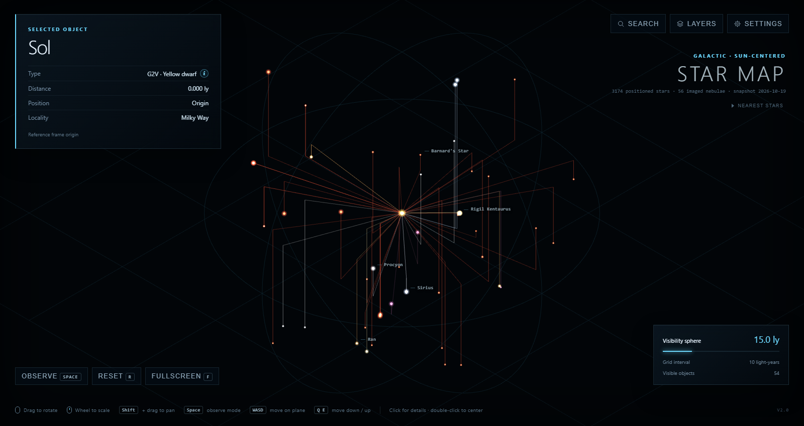
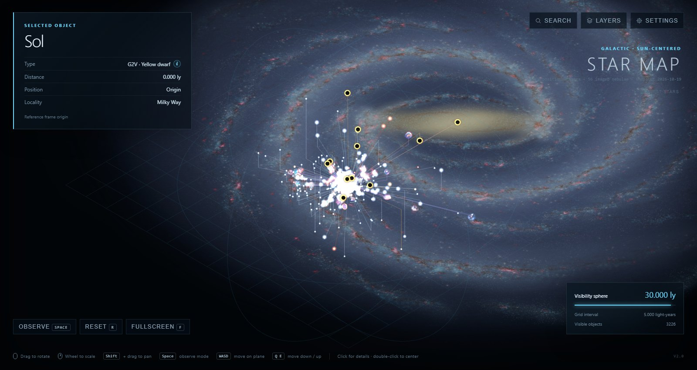

# Star Map

A static, dependency-free WebGL star map with Sol at the origin, reaching from
the nearest stars to the Galactic centre and the Magellanic Clouds. The browser
renders a checked-in catalog snapshot of 3,174 positioned stars and 56 imaged
nebulae over a calibrated picture of the Milky Way, by default in the Galactic
reference frame; three Python builders regenerate the snapshot from WGSN,
SIMBAD, Gaia DR3, VizieR and Wikimedia Commons.

Current version: **V2.0** (see [Versioning](#versioning)).





## Contents

- [Features](#features)
- [Running the map](#running-the-map)
- [Installing as an app](#installing-as-an-app)
- [Controls](#controls)
- [Interface](#interface)
- [Observation mode](#observation-mode)
- [Reference frames](#reference-frames)
- [Galaxy background](#galaxy-background)
- [Data](#data)
- [Rebuilding the data](#rebuilding-the-data)
- [Verification](#verification)
- [Sources and cautions](#sources-and-cautions)
- [Versioning](#versioning)
- [Licence](#licence)

## Features

- Galactic reference frame by default: the grid is the Galactic plane and the
  X axis points at the Galactic centre; the ICRS equatorial frame remains
  selectable. The catalog itself stays in ICRS.
- Isometric orthographic view (pitch 35.26°, yaw 225° in the Galactic frame
  and 45° in the equatorial frame); default visibility sphere of 15 ly over a
  10 ly reference grid; wheel scaling from 1 to 50,000 ly with grid intervals
  from 1 to 10,000 ly.
- 3,174 positioned stars in nine layers, including a curated set of famous
  objects: Sagittarius A\*, VY Canis Majoris, Cygnus X-1, the Gaia black holes,
  the Crab and Vela pulsars, Kepler exoplanet hosts.
- 56 nebulae and supernova remnants drawn as their telescope images (public
  domain, CC0 or CC BY files from Wikimedia Commons), scaled to physical size.
- A calibrated picture of the Milky Way on the Galactic plane, centred on
  Sagittarius A\*, that fades in as the visibility sphere grows.
- Observation mode: a first-person view of the sky from any focused object.
- Search with aliases and identifiers, layer switches, display settings that
  persist in the browser, and an offline type-information popup.
- Touch input for phones and tablets: pinch, two-finger pan, tap and
  double-tap, with layouts for narrow and short screens.
- Installable as a home-screen web app (PWA) with an offline cache.
- No build step, no third-party packages; runs from `file://`.

## Running the map

Requirement: a browser with WebGL. Python 3 is needed only to serve the
directory or to rebuild the data.

Open `index.html` directly, or serve the repository root:

```powershell
python -m http.server 8000
```

Then visit `http://localhost:8000`.

The layout is designed for a 1600 × 850 px viewport and shrinks to the browser
window; a compact layout applies below 720 px width, a short layout below
520 px height, and 320 px is the minimum width. **Fullscreen** (`F`) uses the
entire display; the button is hidden where the browser has no Fullscreen API
(iPhone) and when the map runs as an installed app. Rendering is capped at a
device pixel ratio of 2.

## Installing as an app

The map is a progressive web app: `manifest.json` declares the name, icons
(`icons/`) and standalone display, and `sw.js` is a service worker that caches
every file on first load (about 10.7 MB) and serves it cache-first afterwards,
so an installed copy starts and runs without a network connection.

Requirements: the page must be served over HTTPS (or from `localhost`);
service workers are not registered over plain HTTP or from `file://`, where
the map still runs, only without the offline cache. Any static host is
sufficient, for example GitHub Pages for this repository.

- **iOS and iPadOS:** open the page in Safari, choose **Share**, then **Add to
  Home Screen**. The icon opens the map as a standalone app.
- **Android:** Chrome offers **Install app** (or **Add to Home screen**) in
  its menu once the page has loaded over HTTPS.
- **Desktop Chrome and Edge:** the install icon in the address bar creates a
  windowed app.

Updates: the worker precaches the files listed in `PRECACHE_URLS` in `sw.js`
under the name in `CACHE_VERSION`. After changing any of those files, change
`CACHE_VERSION`; the next visit installs the new cache and removes the old one.
`node tests/pwa.test.js` checks that the manifest, icons, page head and
precache list are consistent.

## Controls

| Input | Map mode | Observation mode |
| --- | --- | --- |
| Drag | Rotate | Turn the viewing direction |
| `Shift` + drag | Pan along the reference plane | – |
| Wheel | Visibility radius (1 to 50,000 ly) | Maximum visibility distance |
| Click | Select the object | Select the object |
| Double-click | Centre the view on the object | Move the observer to the object |
| `W` `A` `S` `D` / `Q` `E` | Move the view centre on / off the plane | – |
| `Space` | Enter observation mode | Return to map mode |
| `R` | Reset the view | Reset the view |
| `F` | Toggle fullscreen | Toggle fullscreen |
| Touch: one-finger drag | Rotate | Turn the viewing direction |
| Touch: pinch | Visibility radius | Maximum visibility distance |
| Touch: two-finger drag | Pan along the reference plane | Turn the viewing direction |
| Touch: tap / double-tap | Select / centre | Select / move the observer |

The reference plane is the Galactic plane in the default frame and the
celestial equator in the equatorial frame. Mouse, keyboard and touch work side
by side on hybrid devices. The complete mapping, including search-panel keys,
pick rules and touch details, is documented in [KEYBOARD.md](KEYBOARD.md).

## Interface

### Selection panel (upper left)

A click shows the object's name, type, distance from Sol, Cartesian position
in the selected reference frame, and **locality** (host galaxy: "Milky Way"
for almost every object, "Large Magellanic Cloud" for R136a1, WOH G64,
S Doradus, the Tarantula Nebula and SN 1987A). The type is the SIMBAD spectral
type; black holes and neutron stars show their class first, followed by the
companion's spectral type where SIMBAD records one. Objects without a spectral
type (643 of the positioned rows, such as Anon Lyr or Worthey 1) read "No
spectral type · unclassified". The source line lists the SIMBAD and Gaia DR3
identifiers, the astrometry source, the distance quality flag and, where
applicable, the literature citation. Nebulae additionally show their image
with author, licence and a link to the Wikimedia Commons file page, the
physical and angular extent, and the distance with its error and source. Stars
take precedence over nebulae when both lie within the pick radius. The panel
shows Sol until an object is selected.

The circular **i** beside the type opens a compact offline description of the
stellar family or nebula class. The descriptions in `data/star-types.js` are
locally stored paraphrases of the linked English Wikipedia articles (stellar
families retrieved 2026-07-11, nebula classes 2026-08-26); the popup keeps the
catalog code visible and links to the source article.

### Labels and Sol indicator

Up to 28 labels are drawn for objects with a fame score of at least 100 and
for the selected object, with a minimum separation of 55 px. When the Sol
indicator is enabled, the selected object receives a gold line toward Sol and
a label with its distance in light-years (map mode only).

### Nearest stars (right edge, below the title)

A collapsible list of the stars currently visible on the map, ordered by
ascending distance from the selected object (Sol when nothing is selected).
Collapsed by default, the control is a borderless label and performs no
computation. Opened, it gains a dim frame and lists at most 20 stars, or as
many as fit above the scale panel without scrolling, each with its colour,
name and distance from the reference object. Sol is listed when another object
is selected. The list follows every change of view and selection. A click on a
row selects that star, so the list re-orders around it; a double-click centres
the view on it.

### Search

The search field matches Sol, every positioned star and every nebula by name,
alias (Messier and NGC designations) and SIMBAD, HIP or HD identifier. Results
are ranked by match quality (exact, prefix, word prefix, substring,
identifier), then fame, then distance; nine are listed. Selecting a result
centres the view on the object and reduces the visibility radius to 5 ly if it
is larger; a hidden layer containing the object is re-enabled. In observation
mode the observer travels to the object instead.

### Layers

Ten layers with object counts, all enabled on start: red dwarfs, yellow
dwarfs, other main-sequence stars, white dwarfs, neutron stars and pulsars,
black holes, giants and supergiants, brown dwarfs, other or unknown objects,
and imaged nebulae. **All** re-enables every layer. Layer choices are not
persisted.

Stars are drawn as point sprites with a bright core and halo in their spectral
colour, blended additively. Black holes use a distinct icon: a dark disc inside
a bright, one-sided accretion ring in a warm orange tint, drawn with ordinary
alpha blending so that the disc occludes what lies behind it. The same tint
marks their drop lines and contact lines.

### Settings

The gear menu changes the display only; catalog data is unaffected. Every
setting is saved in the browser's `localStorage` under the key
`star-map.settings` as soon as it changes and restored on the next visit of
the same browser profile; stored values that are unknown or out of range fall
back to the defaults. **Defaults** restores and saves the default values.
Where storage is unavailable (private browsing, blocked site data) the map
runs with the defaults for the session.

- **Reference frame:** Galactic (default) or Equatorial (ICRS); see
  [Reference frames](#reference-frames). Switching converts the view centre,
  the observer and the viewing directions: the line of sight is kept, every
  object keeps its distance from the screen centre, and the image turns
  about the centre by one angle because screen-up follows the other pole.
- **Grid:** off, light (default) or prominent neon blue. In observation mode
  the same setting controls the sky globe.
- **Grid normals:** off, light (default) or prominent. Each visible object
  receives a drop line in its spectral colour from the Z = 0 plane to its
  position; objects within 0.2 % of the radius of the plane receive none.
- **Contact lines:** a switch (on by default) and a transparency slider from
  0 % (opaque) to 100 % (invisible), default 75 %. Lines are drawn flat on the
  Z = 0 plane from the focused object's foot point (the base of its
  perpendicular) to the foot point of every other visible object, each in that
  object's spectral colour. If the focused object lies off the plane, its own
  perpendicular is drawn first so that it stays connected to the fan. The
  focused object is the one centred by double-click, search or reset (Sol on
  start); a single click changes the selection but not the focus. The slider
  exists because the fan is informative around a sparse neighbourhood and
  overwhelming in a dense field.
- **Star size:** normal, large (default) or accurate. Accurate derives a
  compressed logarithmic visual-luminosity scale (2.5 to 28 px) from apparent
  magnitude and distance; objects without photometry use a neutral size.
  Black-hole icons use a fixed size per mode (17, 22 or 14 px).
- **Sol indicator:** show or hide the direction line and distance label.
- **Cropping sphere:** show or hide the wireframe visibility boundary; the
  spherical cutoff itself remains active.
- **Galaxy background:** show (default) or hide the Milky Way picture on the
  Galactic plane (see [Galaxy background](#galaxy-background)).

### Scale panel and status

The scale panel shows the visibility radius with a logarithmic scale bar (a
slider in observation mode), the current grid interval and the number of
visible objects including Sol. The grid interval follows the radius: 1, 5, 10,
50, 100, 500, 1,000, 5,000 or 10,000 ly, chosen so that about 14 lines per
axis cross the sphere. The title block names the frame ("Galactic" or "ICRS",
both Sun-centred) and reports the positioned star count, the nebula count and
the snapshot date. An overlay reports a missing WebGL context or a missing
catalog.

The wire sphere is the active three-dimensional crop boundary. The Z = 0 plane
of the grid is the Galactic plane in the Galactic frame and the celestial
equator in the equatorial frame; the two planes are inclined 62.87° to each
other.

## Observation mode

`Space` or **Observe** switches to a first-person perspective view (60°
vertical field of view) from the focused object, Sol on start. The observer is
treated as a point; nothing is occluded and the observer's own object is not
drawn. The planar grid, cropping sphere, normals, contact lines, galaxy
background and Sol indicator fade out; the grid setting instead draws a sky
globe divided into 45° azimuth and altitude sectors in the selected frame
(Galactic longitude and latitude, or right ascension and declination).

- Dragging turns the viewing direction only. The direction starts along the
  frame's X axis at altitude 0°: toward the Galactic centre in the Galactic
  frame, toward RA 0h in the equatorial frame. It is retained when switching
  between modes; Reset restores it.
- The scale panel replaces its bar with a logarithmic slider (1 to 50,000 ly)
  for the maximum visibility distance; the wheel changes the same value. The
  distance is initialised from the map radius on first entry and retained
  thereafter. Objects beyond 75 % of the distance fade linearly and vanish at
  the limit; Sol is subject to the same rule when observed from elsewhere.
- Double-clicking an object, or choosing a search result, moves the observer
  to that object with an animated transition.
- Nebula sprites are scaled to their apparent angular size from the observer.
- Entering and leaving the mode is animated like double-click navigation; the
  transition blends from a narrow-field perspective that approximates the
  orthographic map.

## Reference frames

The catalog stores every position in the ICRS equatorial frame delivered by
SIMBAD and Gaia DR3: X toward RA 0h / Dec 0°, Y toward RA 6h / Dec 0°, Z toward
the north celestial pole. In that frame the grid plane is the celestial
equator, Earth's equator projected onto the sky, and the Galaxy's disc crosses
it at 62.87° along a line through Sol toward RA 18h51m.

The default **Galactic** frame rotates every displayed position by the matrix
of the Hipparcos Catalogue (ESA 1997, Vol. 1, Sect. 1.5.3), which expresses
the IAU 1958 Galactic system (Blaauw et al. 1960) in J2000 coordinates:

```text
             ⎡ −0.0548755604  −0.8734370902  −0.4838350155 ⎤
x_gal = A ·  ⎢  0.4941094279  −0.4448296300   0.7469822445 ⎥ · x_icrs
             ⎣ −0.8676661490  −0.1980763734   0.4559837762 ⎦
```

The rows are the Galactic axes in ICRS: X toward the Galactic centre
(longitude 0°), Y toward longitude 90° (the direction of Galactic rotation),
Z toward the north Galactic pole (RA 192.85948°, Dec +27.12825°). The grid
plane is then the Galactic plane, `W` `A` `S` `D` and `Shift` + drag move
within the disc, `Q` `E` move perpendicular to it, drop lines show the height
above or below the disc, and Sagittarius A\* reads X 26,996 · Y −26 · Z −22 ly
(longitude 359.944°, latitude −0.046°). The frame is a display rotation only:
`data/stars.js`, `data/nebulae.js` and the CSV tables remain ICRS, and
distances are unchanged.

Equatorial frame: the previous behaviour, selectable in the settings. The IAU
plane passes through the Sun by definition, although the Sun lies some
10 to 20 pc above the mid-plane of the neutral-hydrogen layer that defines it;
the map makes no correction for that height.

## Galaxy background

`data/galaxy.js` embeds the ESO/NASA artist's impression of the Milky Way by
R. Hurt (Wikimedia Commons file *Artist's impression of the Milky Way.jpg*,
ESO eso1339g, public domain) as a 3840 × 3840 px JPEG data URI (2.0 MB). The
map draws it as one textured quad, blended additively, on the plane through
Sagittarius A\* perpendicular to the north Galactic pole. In the Galactic frame
that plane is the grid plane (22 ly below it at Sgr A\*, whose latitude is
−0.046°); in the equatorial frame it is inclined 62.87° to the grid.

Placement is calibrated, not assumed. The annotated twin of the picture
(eso1339e, identical framing) carries Galactic-longitude lines and distance
rings around the Sun; `scripts/build_galaxy.py` records the pixel positions
measured on its 3840 px thumbnail on 2026-10-24: the bar centroid at
(1917.7, 1921.1), the Sun at the intersection of the 0° and 90°/270° lines at
(1919.8, 2654.7), rings every 141.2 px, i.e. 5,000 ly, hence 35.41 ly per
pixel and a painted Sun–centre distance of 25,977 ly. Longitude 0° points up
from the Sun and 90° to the left, the view from the north Galactic pole. At
run time the picture is centred on the catalog position of Sgr A\* and
enlarged by 3.9 % (36.80 ly per pixel, 141,300 ly across) so that its painted
Sun coincides with Sol; the painted centre–Sun pixel vector defines the
picture's axes, so the alignment error is the 0.07° offset between Sgr A\*
and the IAU origin. `node tests/catalog.test.js` checks the calibration
against the Sgr A\* distance.

Sagittarius A\* is the compact radio source at the dynamical centre of the
Milky Way and the position of its supermassive black hole (GRAVITY
Collaboration 2022: R0 = 8.277 kpc, the catalog distance). The IAU Galactic
coordinate origin was fixed in 1958, before Sgr A\* was identified (Balick &
Brown 1974); Sgr A\* lies at l = 359.944°, b = −0.046° (Reid & Brunthaler
2004), 0.07° or about 30 ly from the formal origin, which is below the
resolution of the picture. Using Sgr A\* as the Galactic centre is therefore
correct for this map.

Rendering: the texture is resampled to a 4096 px (2048 px on compact layouts)
power-of-two square with mipmaps and anisotropic filtering. One texel spans
about 37 ly, so the picture carries no structure inside a small sphere; its
opacity rises logarithmically from zero at a 100 ly radius to full at
20,000 ly and is zero in observation mode, where the plane would be seen
edge-on. The square border is faded out; the orthographic depth range of
±8 eye distances keeps an inclined plane from being clipped in the view
corners. The picture is an artist's impression: the scale and the Sun–centre
line are calibrated, the spiral-arm layout is schematic, and the bulge was
updated by ESO in 2013 from VISTA survey data.

## Data

### Files

| File | Content |
| --- | --- |
| `data/stars.js` | Browser payload: positioned rows in compact form (ICRS); loads from `file://` without fetch or CORS. |
| `data/stars.csv` | Auditable table of every candidate row, including rows without coordinates or distance. |
| `data/catalog-metadata.json` | Generation time, selection constants, source endpoints, row counts, coordinate frame and distance policy. |
| `data/nebulae.js` | Browser payload: 56 nebulae with embedded base64 JPEG images. |
| `data/nebulae.csv` | Audit table of the nebulae without image bytes. |
| `data/nebulae/` | Downloaded Wikimedia thumbnails and the cached `sources.json`. |
| `data/galaxy.js` | Browser payload: the Milky Way picture as a base64 JPEG with licence, credit and calibration. |
| `data/galaxy/` | The downloaded 3840 px thumbnail and the cached `source.json`. |
| `data/star-types.js` | Offline type descriptions for the information popup. |
| `manifest.json`, `sw.js`, `icons/` | Web app manifest, offline service worker and app icons (180, 192, 512 px). |
| `CREDITS.md` | Per-image attribution and licence list, including the galaxy picture. |

### Catalog selection

"SIMBAD named" denotes a stellar SIMBAD object with at least one identifier
whose literal prefix is `NAME `. SIMBAD pads identifiers internally (`HD  95735`,
`Wolf   28`); all identifier matching in the builder is whitespace-insensitive.
Every such object is retained in the CSV, including entries without
coordinates or without a defensible distance. Only the subset with finite,
quality-accepted 3D coordinates is emitted to `stars.js`; a later rebuild
places an object automatically once its source astrometry improves.

The candidate union comprises:

1. Every star in the current IAU/WGSN Catalog of Star Names.
2. Every SIMBAD stellar object with at least one identifier beginning `NAME `.
3. Bright Star Catalogue V/50 stars with Johnson V below 4.0, resolved to
   SIMBAD by HR identifier.
4. Stellar SIMBAD objects whose catalog parallax places them within 50 ly.
5. The explicit famous-object list `CURATED` in `scripts/build_catalog.py`:
   the Galactic-centre black hole Sagittarius A\* with the star S2 and the
   Pistol Star; hypergiants such as VY Canis Majoris, NML Cygni,
   Westerlund 1-26, RW and VV Cephei, Rho Cassiopeiae, HR 5171 A,
   V838 Monocerotis, WR 104 and WR 124, and the LMC members WOH G64 and
   S Doradus; stellar-mass black holes (Cygnus X-1, V404 Cygni, Gaia BH1 to
   BH3, SS 433, V4641 Sgr, A0620-00, GRS 1915+105, MAXI J1820+070); pulsars
   (Crab, Vela, Geminga, PSR B1919+21, PSR J0437-4715); and exoplanet hosts and
   nearby classics (Kepler-186, -452, -22 and -90, HD 209458, the Methuselah
   star HD 140283, T CrB, RR Lyrae, Wolf 359, Gliese 581, Lalande 21185,
   Kapteyn's, Luyten's, Teegarden's and Van Maanen's stars, WISE 0855−0714).
   Curated labels take precedence over SIMBAD `NAME` identifiers but never
   over an official IAU name (Mu Cephei therefore appears as "Garnet Star",
   T CrB as "Blaze Star").

### Row semantics

Resolved rows are deduplicated by SIMBAD `oid`, never by display name. A row
represents the SIMBAD object that was resolved: a component remains a
component, an unresolved system remains a system. Non-stellar objects such as
exoplanets are excluded by requiring stellar membership in SIMBAD's object-type
hierarchy. Every current WGSN entry is retained even if it cannot be uniquely
resolved in SIMBAD; such rows carry WGSN coordinates but no invented distance.
Stephenson 2-18 is retained as a clearly marked literature-only exception
because no unique SIMBAD object resolves under that popular name.

Display names use, in order: official IAU name, curated label, `NAME`
identifier, Bayer designation, Flamsteed designation, HD, HIP, Gaia DR3, SIMBAD
main identifier. The CSV retains every SIMBAD identifier for audit.
`stellar_category` is derived reproducibly from the SIMBAD object type and the
primary component of the spectral type (a companion's `+B2V` does not turn
Antares into a dwarf; legacy `dM6` denotes a red dwarf, not a white dwarf).
SIMBAD types black holes as X-ray or spectroscopic binaries, so the black-hole
layer is populated from the explicit `CATEGORY_OVERRIDES` table.
"Main-sequence star" is the English term for German *Hauptreihenstern*; red
and yellow dwarfs are exposed as sublayers of that class.

`locality` names the host galaxy. It defaults to "Milky Way", is curated for
known Large Magellanic Cloud members, and any positioned row beyond 100,000 ly
without a curated host is flagged rather than called Galactic.

### Nebulae and supernova remnants

`data/nebulae.js` and `data/nebulae.csv` hold 56 imaged objects: H II
regions, planetary nebulae, supernova remnants, reflection and dark nebulae,
two protoplanetary nebulae and the Homunculus. They are curated in `NEBULAE`
in `scripts/build_nebulae.py` with, per object:

- **Position** from the SIMBAD basic table for the pinned identifier; curated
  coordinates only for the Pillars of Creation, which SIMBAD does not list
  separately.
- **Distance** as an explicit literature value with asymmetric error, citation
  and ADS bibcode, and a quality flag in the stars' vocabulary
  (`literature_distance`, `uncertain_literature_distance`,
  `host_system_distance`). Typical sources are Gaia parallaxes of the
  ionizing stars or planetary-nebula central stars (Kuhn et al. 2019, Zucker
  et al. 2020, Bailer-Jones et al. 2021, Chornay & Walton 2021), VLBI maser
  parallaxes, expansion parallaxes and the LMC eclipsing-binary distance.
  Objects without a defensible distance (Boomerang, Stingray, Egg and Necklace
  nebulae, the Gum Nebula) are omitted.
- **Extent** as an apparent size in arcminutes (SIMBAD `galdim_majaxis` where
  preferred, otherwise curated). The sprite is drawn `2 · d · tan(θ/2)`
  light-years across: the Orion Nebula fills a 5 ly view, the Ring Nebula is a
  1 ly speck. A minimum on-screen size of 22 px keeps small nebulae visible
  and selectable; the maximum is 90 % of the canvas height.
- **Image:** a pinned Wikimedia Commons file. The builder reads the licence
  from the file's `extmetadata` and accepts only public domain, CC0 and
  CC BY; any other licence aborts the build. The standard 500 px thumbnail
  (Wikimedia serves only its standard widths to external requests) is stored
  in `data/nebulae/` and embedded in `nebulae.js` as a base64 data URI so the
  map works offline. `CREDITS.md` lists every file with author, licence and
  link; the selection panel shows the same attribution.

Sprites are blended additively over the black sky with a soft circular edge,
which removes the black background of the source images. The **Nebulae** layer
hides them all.

### Astrometry and coordinates

Gaia DR3 astrometry is accepted only when the parallax is positive,
`parallax_over_error >= 10`, RUWE is absent or at most 1.4, and the duplicate
source flag is false. Otherwise the builder uses a positive SIMBAD parallax
with adequate signal-to-noise, an explicit literature distance from the
`LITERATURE_DISTANCE_PC` table (each entry carries the citation shown in the
selection panel, e.g. Sgr A\* at 8.277 kpc from the GRAVITY Collaboration 2022
S2 orbit, VY CMa at 1.20 kpc from the VLBA maser parallax of Zhang et al.
2012, V404 Cygni from its VLBI parallax), or leaves distance and coordinates
blank. A low-quality distant parallax is never inverted blindly; a literature
entry can also be forced over a formally acceptable but known-spurious
parallax (WR 104).

For an accepted parallax `p` in milliarcseconds:

```text
distance_pc = 1000 / p
distance_ly = distance_pc × 3.261563777
x = distance_ly × cos(dec) × cos(ra)
y = distance_ly × cos(dec) × sin(ra)
z = distance_ly × sin(dec)
```

The Sun-centred equatorial frame has X toward RA 0° / Dec 0°, Y toward
RA 90° / Dec 0°, and Z toward Dec +90°. The snapshot also stores spherical
`r`, `phi = RA` and `theta = 90° − Dec`. The Galactic display frame is derived
from these values at load time as described in
[Reference frames](#reference-frames).

## Rebuilding the data

Python 3.10 or later; standard library only.

```powershell
python scripts/build_catalog.py
python scripts/build_nebulae.py
python scripts/build_galaxy.py
```

`build_catalog.py` reads the current WGSN and VizieR Bright Star tables (TAP
with automatic fallback to the classic ASU service), adds every SIMBAD `NAME`
star, resolves and deduplicates in SIMBAD, collects all alternate identifiers,
then queries Gaia DR3 by resolved source ID. The remote services are live
dependencies; a later rebuild may produce a different snapshot. Generation
time, selection constants, endpoints, row counts, coordinate frame and
distance policy are recorded in `data/catalog-metadata.json`. `--skip-gaia`
performs a fast diagnostic rebuild from SIMBAD astrometry only; `--output`
selects another data directory.

`build_nebulae.py` queries SIMBAD and the Commons API with a descriptive
User-Agent, pauses between downloads, honours `Retry-After`, and skips files
already present in `data/nebulae/`. Options: `--refresh` re-downloads images;
`--offline` rebuilds `nebulae.js`, `nebulae.csv` and `CREDITS.md` from the
cached `sources.json` and images without network access; `--width` selects
another standard thumbnail width; `--output`, `--images` and `--credits`
override the destinations. The builder rewrites `CREDITS.md` but preserves
the marked galaxy section.

`build_galaxy.py` shares the Commons helpers, verifies the licence of the
pinned picture, downloads its 3840 px thumbnail into `data/galaxy/`, writes
`data/galaxy.js` with the calibration rescaled to the embedded width, and
replaces the marked galaxy section of `CREDITS.md`. Options: `--width`
(standard widths only), `--refresh`, `--offline`, `--output`, `--images`,
`--credits`.

## Verification

```powershell
node tests/catalog.test.js
node tests/pwa.test.js
```

The catalog test validates `data/stars.js`, `data/nebulae.js`,
`data/galaxy.js`, `data/star-types.js` and `CREDITS.md`: finite coordinates
consistent with the stored distances, known categories and localities,
required objects, cited distances, allowed image licences, complete
attribution, and a galaxy calibration consistent with itself and with the
Sgr A\* distance. The PWA test validates the manifest, the icons, the page
head, the service worker's precache list and the version declaration. A
headless-Chromium recipe for visual and touch verification is kept in
`.claude/skills/verify/`.

## Sources and cautions

- [IAU/WGSN Catalog of Star Names](https://exopla.net/star-names/modern-iau-star-names/)
- [SIMBAD astronomical database](https://simbad.cds.unistra.fr/simbad/)
- [Gaia DR3 archive and documentation](https://gea.esac.esa.int/archive/documentation/GDR3/)
- [VizieR Bright Star Catalogue V/50](https://vizier.cds.unistra.fr/viz-bin/VizieR?-source=V/50/catalog)
- [Wikimedia Commons](https://commons.wikimedia.org/) for nebula imagery and
  the galaxy picture (per-file credits in `CREDITS.md`); NASA/ESA/STScI, ESO,
  ESA/Webb and NOIRLab images are used under their public-domain or CC BY
  terms.
- Galactic frame: Blaauw, Gum, Pawsey & Westerhout 1960 (MNRAS 121, 123) for
  the IAU 1958 definition; the Hipparcos Catalogue (ESA 1997, SP-1200, Vol. 1,
  Sect. 1.5.3) for the J2000 pole, node and rotation matrix; Liu, Zhu & Zhang
  2011 (A&A 526, A16) on the transformation's limits; Reid & Brunthaler 2004
  (ApJ 616, 872) for the position and motion of Sgr A\*.
- Literature distances are cited per object in `data/stars.csv` (`notes`)
  and `data/nebulae.csv` (`distance_source`, `distance_bibcode`).

"Best-known" is a documented selection policy, not an astronomical class.
Gaia, SIMBAD and WGSN have different purposes and update schedules. Multiple
systems, saturated bright stars, variables, crowded fields and distant
supergiants are especially likely to need component-level or literature
review. Several famous distances remain contested (Mu Cephei, Rho Cas,
HR 5171 A, Tycho's remnant, the dispersion-measure distance of PSR B1919+21);
they are included with the `uncertain_literature_distance` flag and the
competing values in their notes rather than omitted or presented as settled.
The quality and provenance columns are part of the result, not optional notes.
The galaxy picture is an illustration whose arm layout is not a measurement.

## Versioning

The application carries a two-part version number, major.minor, declared as
the global `window.STAR_MAP_VERSION` at the top of `app.js` and shown dimly as
`V2.0` in the lower-right corner of the map. The minor number is raised for
new features and visible changes in behaviour; the major number is raised for
changes that alter data formats, the coordinate frame or established
behaviour. Patch levels are not used. The data snapshot has its own date in
`data/catalog-metadata.json`, and the offline cache has its own
`CACHE_VERSION` in `sw.js`; neither is tied to the application version.
`node tests/pwa.test.js` checks that the declaration, the footer element and
this file agree.

| Version | Date | Content |
| --- | --- | --- |
| V2.0 | 2026-10-24 | Galactic reference frame as the default display frame (major: the displayed coordinate frame changed; the catalog files remain ICRS); equatorial frame selectable; galaxy background with its builder and tests; contact lines with a transparency slider (default 75 %); display settings persisted in `localStorage` with a Defaults button; grid intervals extended to 10,000 ly; wider orthographic depth range. |
| V1.0 | 2026-10-19 | First numbered version: observation mode, contact lines, display settings, nearest-stars list, touch input, installable web app with offline cache, black-hole icon. |

## Licence

Code and data tables are released under the MIT licence (see `LICENSE`).
Nebula images and the galaxy picture retain their individual licences listed
in `CREDITS.md`.
